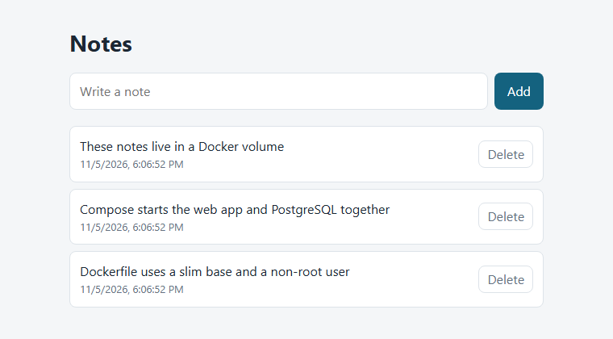

# Docker Notes App


A small notes app run entirely with Docker: a **FastAPI** web container and a **PostgreSQL** database container, started together with one command. Notes are kept in a Docker volume, so they survive when the containers are removed.



## Run it

Needs Docker with Compose (Linux, macOS or Windows).

```bash
git clone https://github.com/FAROUK-debug/docker-notes-app.git
cd docker-notes-app
cp .env.example .env       # then choose your own password in .env
docker compose up --build
```

Open http://localhost:8000.

## Useful commands

```bash
docker compose ps                  # both services, with their health
docker compose logs -f web         # follow the web app's logs
docker compose down                # remove the containers, keep the data
docker compose down -v             # also delete the volume and all notes
```

## Check that data survives

[`scripts/check_persistence.sh`](scripts/check_persistence.sh) adds a note, runs `docker compose down`, starts everything again and checks the note is still there. GitHub Actions runs it on every push.

```bash
$ bash scripts/check_persistence.sh
Added note: survives-1793898392
PASS: the note survived docker compose down / up
```

## How it works

```
browser ──► web (FastAPI, port 8000) ──► db (PostgreSQL) ──► volume notes_data
```

- **Network:** Compose puts both containers on one private network. The web app reaches the database by its service name, `db`.
- **Start order:** the web container waits until the database's health check passes.
- **Database port:** it isn't published to the host, so only the web container can reach PostgreSQL.

## Good practices

- **Slim base image:** `python:3.12-slim`.
- **Layer cache:** dependencies are installed before the code is copied, so changing the code doesn't reinstall them.
- **Non-root:** the app runs as a system user named `app`.
- **Health checks:** on both containers.
- **`.dockerignore`:** keeps `.env`, `.git` and the docs out of the image.
- **Secrets:** the password lives in `.env`, which is never committed. [`.env.example`](.env.example) shows the format.

## Project layout

```
main.py                        web app and API
static/index.html              the page
Dockerfile                     how the web image is built
compose.yaml                   web + database + volume
scripts/check_persistence.sh   data-survival test
```

## Tech

Python · FastAPI · PostgreSQL · Docker · Docker Compose · GitHub Actions
